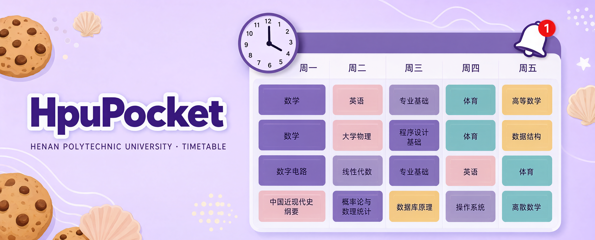

<div align="center">



[](https://github.com/ZYH-officials/HpuPocket/releases)
[](LICENSE)
[](#构建)
[](#构建)
[](#构建)

河南理工大学（HPU）学生的原生课表 App，个人开源项目。
把教务、实验平台、作业平台分散的网页系统，整理成一个可离线查看的 Android 应用。

</div>

> 非学校官方应用。课表、考试与成绩数据以教务系统为准。

## 下载安装

到 [Releases](https://github.com/ZYH-officials/HpuPocket/releases) 下载最新 APK，Android 12（API 31）及以上可直接安装：

| 包 | 说明 | 下载位置 |
|---|---|---|
| `HpuPocket-<版本>.apk` | 稳定版（main 分支），日常使用 | [正式发行版](https://github.com/ZYH-officials/HpuPocket/releases/latest) |
| `HpuPocket-<版本>-dev.apk` | 开发版（dev 分支），设置页多开发者选项 | 预发行版（Releases 页标 Pre-release） |

- 正式签名发行；从旧的 debug 签名包升级需**卸载重装**（会丢登录态与缓存），此后同签名可直接覆盖升级
- 小米 / 华为 / OPPO / vivo 等机型：装好后在设置页按提示开启**电池优化白名单**与**自启动**，否则上课提醒会被系统推迟

## 功能

| 模块 | 说明 |
|---|---|
| 课表 | 教务理论课 + 实验平台实验课自动合并，含教室、教师、周次；缓存离线秒开 |
| 今日 | 当天课程时间轴与「距下节课」倒计时，每分钟自动刷新 |
| 考试 / 成绩 | 考试安排与倒计时、成绩查询 |
| 空闲教室 | 按日期、楼栋查询空闲教室 |
| 作业 | 作业平台待提交汇总（第三方服务，账号单独填写） |
| 提醒 | 上课提醒（精确闹钟 + 每日自愈重排）、每周课表概览 |
| 会话 | 会话过期自动重登；退出登录清会话与缓存 |
| 诊断 | 一键导出日志（不含密码与原始响应），方便反馈问题 |

## 分支

| 分支 | 说明 |
|---|---|
| `main` | 稳定版，面向日常使用，不含开发者选项 |
| `dev` | 开发版，设置页含开发者选项（测试通知、模拟会话过期等） |

功能改动先进 `dev`，验证后合进 `main`；两分支仅差一个开发者选项开关。

## 构建

- Android Studio（或 JDK 17+）打开本目录，`./gradlew assembleRelease`
- minSdk 31，targetSdk 37；UI 为 Jetpack Compose + Material 3 Expressive（material3 1.5.0-rc01）
- 仓库不含签名密钥：根目录放一份 `keystore.properties`（storeFile/storePassword/keyAlias/keyPassword，已 gitignore）即用正式签名；没有则自动退回 debug 签名，克隆即可编译
- 正式签名与 debug 签名互不兼容，更换签名需卸载重装

## 项目结构

```
app/src/main/java/com/hpu/timetable/
├── data/       教务(jw)、实验(lab)、作业(hw)协议与缓存，会话自动重登(auth)
├── notify/     精确闹钟提醒、每日自愈重排、开机恢复
├── ui/         Compose 界面：课表 / 今日 / 考试 / 成绩 / 教室 / 作业 / 设置 / 关于
├── MainActivity.kt
└── TimetableApp.kt   日志与崩溃记录
```

## 隐私

- 学号密码经 Android Keystore 加密后只存本机，可在登录页关闭记住密码
- 课表、成绩等缓存只存本机，没有自建服务器，不上传任何数据
- 退出登录清会话与缓存，卸载即全清
- 只读查询，不代替用户提交任何操作
- 「导出日志」由用户主动触发，日志不含密码与原始响应

## 致谢

- 协议与架构思路参考 [ZZUPocket](https://github.com/3beuml/ZZUPocket)（MIT）
- 首页短句来自 [一言](https://hitokoto.cn)

## 许可证

[MIT](LICENSE)